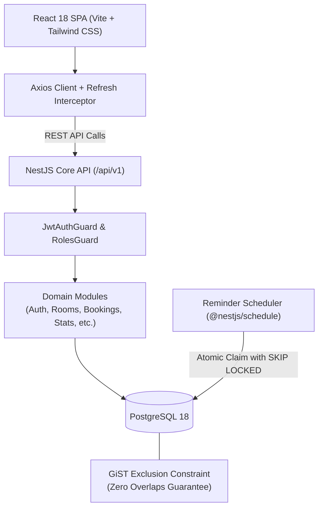

# Meeting Room Booking System - Technical Architecture & Implementation Plan

## 1. System Architecture Overview

The system is designed as a production-grade, multi-tier enterprise application:
- **Frontend**: Single Page Application built with React 18, Vite, TypeScript, Tailwind CSS, TanStack Query, React Hook Form + Zod, and FullCalendar. Styled with a bespoke dark SaaS theme.
- **Backend**: NestJS application structured into clean domain modules (`auth`, `users`, `rooms`, `bookings`, `notifications`, `reminders`, `stats`, `health`).
- **Database**: PostgreSQL 18 with extensions (`btree_gist`, `citext`), managed via TypeORM hand-crafted SQL migrations (`synchronize: false`).
- **Data Flow**:
  1. React client sends authenticated requests with bearer JWT access token (stored in memory).
  2. NestJS global `JwtAuthGuard` validates the token; `RolesGuard` verifies role permissions.
  3. Services enforce business invariants (30-minute grid alignment, capacity limits, business hours in `Asia/Kolkata`).
  4. TypeORM performs atomic queries/transactions against PostgreSQL.
  5. The PostgreSQL GiST exclusion constraint (`bookings_no_overlap`) enforces the zero-overlap guarantee.
  6. Upon 401 token expiry, Axios interceptor requests `POST /api/v1/auth/refresh` using the secure `httpOnly` cookie, receives a fresh access token, and transparently replays the failed request.



---

## 2. Directory Structure (Monorepo Layout)

```
SFT booking system/
├── docs/
│   ├── DECISIONS.md
│   └── PLAN.md
├── docker-compose.yml
├── package.json               # Root scripts for dev, build, test, seed
├── README.md
├── backend/
│   ├── package.json
│   ├── tsconfig.json
│   ├── nest-cli.json
│   ├── ormconfig.ts
│   ├── .env.example
│   ├── .env
│   ├── src/
│   │   ├── main.ts
│   │   ├── app.module.ts
│   │   ├── common/
│   │   │   ├── decorators/     # @Public, @Roles, @CurrentUser
│   │   │   ├── guards/         # JwtAuthGuard, RolesGuard
│   │   │   ├── filters/        # GlobalExceptionFilter
│   │   │   ├── interceptors/   # Logging, Transform
│   │   │   └── utils/          # DateTime, Luxon helpers
│   │   ├── database/
│   │   │   ├── data-source.ts
│   │   │   ├── migrations/     # Hand-written SQL migrations
│   │   │   └── seeds/          # Idempotent seed script
│   │   ├── modules/
│   │   │   ├── auth/           # Login, Register, Refresh, Me, Password
│   │   │   ├── users/          # User management, roles, deactivation
│   │   │   ├── rooms/          # Room catalog, availability computation
│   │   │   ├── bookings/       # Booking lifecycle, conflict handling, calendar
│   │   │   ├── notifications/  # In-app notifications
│   │   │   ├── reminders/      # Cron scheduler with SKIP LOCKED
│   │   │   ├── stats/          # Admin analytics & employee summaries
│   │   │   └── health/         # DB health check
│   │   └── test/               # Unit, E2E, and Concurrency test suites
├── frontend/
│   ├── package.json
│   ├── vite.config.ts
│   ├── tailwind.config.js
│   ├── postcss.config.js
│   ├── tsconfig.json
│   ├── .env.example
│   ├── .env
│   ├── src/
│   │   ├── main.tsx
│   │   ├── App.tsx
│   │   ├── index.css           # Design tokens and custom theme
│   │   ├── api/                # Axios client, endpoints, types
│   │   ├── context/            # AuthContext, NotificationContext
│   │   ├── components/
│   │   │   ├── layout/         # Sidebar, TopBar, Shell, ProtectedRoute
│   │   │   ├── ui/             # Buttons, Modals, Badges, Inputs, Skeletons
│   │   │   └── bookings/       # BookingDialog, RescheduleDialog, ConflictAlert
│   │   ├── pages/
│   │   │   ├── auth/           # Login, Register
│   │   │   ├── dashboard/      # Employee Dashboard, Admin Dashboard
│   │   │   ├── rooms/          # Room Grid, RoomDetail Drawer
│   │   │   ├── bookings/       # My Bookings (Upcoming/Past/Cancelled)
│   │   │   ├── calendar/       # FullCalendar View
│   │   │   ├── notifications/  # Notifications center
│   │   │   ├── profile/        # Profile & Password management
│   │   │   ├── admin/          # Rooms, Bookings, Users management
│   │   │   └── not-found/      # 404 & 403 pages
│   │   └── test/               # Vitest + React Testing Library suites
```

---

## 3. Database Schema & Migration Specifications

### Migration 1: Extensions & Base Tables
- `CREATE EXTENSION IF NOT EXISTS btree_gist;`
- `CREATE EXTENSION IF NOT EXISTS citext;`
- **users**:
  - `id` UUID PRIMARY KEY DEFAULT gen_random_uuid()
  - `full_name` VARCHAR(120) NOT NULL
  - `email` CITEXT NOT NULL UNIQUE
  - `password_hash` VARCHAR(255) NOT NULL
  - `role` VARCHAR(20) NOT NULL DEFAULT 'EMPLOYEE' CHECK (role IN ('EMPLOYEE', 'ADMIN'))
  - `department` VARCHAR(100) NULL
  - `is_active` BOOLEAN NOT NULL DEFAULT true
  - `created_at` TIMESTAMPTZ NOT NULL DEFAULT now()
  - `updated_at` TIMESTAMPTZ NOT NULL DEFAULT now()
- **refresh_tokens**:
  - `id` UUID PRIMARY KEY DEFAULT gen_random_uuid()
  - `user_id` UUID NOT NULL REFERENCES users(id) ON DELETE CASCADE
  - `token_hash` VARCHAR(255) NOT NULL
  - `expires_at` TIMESTAMPTZ NOT NULL
  - `revoked_at` TIMESTAMPTZ NULL
  - `created_at` TIMESTAMPTZ NOT NULL DEFAULT now()
  - Index on `(user_id, token_hash)`
- **rooms**:
  - `id` UUID PRIMARY KEY DEFAULT gen_random_uuid()
  - `name` VARCHAR(100) NOT NULL
  - `floor_or_location` VARCHAR(100) NOT NULL
  - `capacity` INT NOT NULL CHECK (capacity > 0 AND capacity <= 500)
  - `description` TEXT NULL
  - `amenities` TEXT[] NOT NULL DEFAULT '{}'
  - `status` VARCHAR(20) NOT NULL DEFAULT 'ACTIVE' CHECK (status IN ('ACTIVE', 'MAINTENANCE'))
  - `accent_color` VARCHAR(10) NOT NULL
  - `deleted_at` TIMESTAMPTZ NULL
  - `created_at` TIMESTAMPTZ NOT NULL DEFAULT now()
  - `updated_at` TIMESTAMPTZ NOT NULL DEFAULT now()
  - Unique index: `CREATE UNIQUE INDEX rooms_name_unique ON rooms (lower(name)) WHERE deleted_at IS NULL;`
  - Index: `CREATE INDEX idx_rooms_capacity ON rooms (capacity);`
- **bookings**:
  - `id` UUID PRIMARY KEY DEFAULT gen_random_uuid()
  - `room_id` UUID NOT NULL REFERENCES rooms(id) ON DELETE RESTRICT
  - `user_id` UUID NOT NULL REFERENCES users(id) ON DELETE RESTRICT
  - `title` VARCHAR(120) NOT NULL
  - `description` VARCHAR(500) NULL
  - `attendee_count` INT NOT NULL CHECK (attendee_count > 0)
  - `start_time` TIMESTAMPTZ NOT NULL
  - `end_time` TIMESTAMPTZ NOT NULL
  - `status` VARCHAR(20) NOT NULL DEFAULT 'CONFIRMED' CHECK (status IN ('CONFIRMED', 'CANCELLED'))
  - `reminder_minutes_before` INT NOT NULL DEFAULT 15 CHECK (reminder_minutes_before IN (0, 10, 15, 30, 60))
  - `reminder_sent_at` TIMESTAMPTZ NULL
  - `reschedule_count` INT NOT NULL DEFAULT 0
  - `cancelled_at` TIMESTAMPTZ NULL
  - `cancelled_by` UUID NULL REFERENCES users(id)
  - `cancellation_reason` VARCHAR(500) NULL
  - `created_at` TIMESTAMPTZ NOT NULL DEFAULT now()
  - `updated_at` TIMESTAMPTZ NOT NULL DEFAULT now()
  - `CONSTRAINT check_end_after_start CHECK (end_time > start_time)`
  - Core Guarantee Constraint:
    ```sql
    ALTER TABLE bookings ADD CONSTRAINT bookings_no_overlap
    EXCLUDE USING gist (
      room_id WITH =,
      tstzrange(start_time, end_time, '[)') WITH &&
    )
    WHERE (status = 'CONFIRMED');
    ```
  - Indexes: `(user_id, start_time)`, `(room_id, start_time)`, and partial index `(start_time) WHERE status = 'CONFIRMED' AND reminder_sent_at IS NULL`.
- **notifications**:
  - `id` UUID PRIMARY KEY DEFAULT gen_random_uuid()
  - `user_id` UUID NOT NULL REFERENCES users(id) ON DELETE CASCADE
  - `type` VARCHAR(50) NOT NULL CHECK (type IN ('BOOKING_CONFIRMED', 'BOOKING_RESCHEDULED', 'BOOKING_CANCELLED', 'BOOKING_CANCELLED_BY_ADMIN', 'BOOKING_REMINDER', 'ROOM_UNAVAILABLE'))
  - `title` VARCHAR(200) NOT NULL
  - `message` TEXT NOT NULL
  - `booking_id` UUID NULL REFERENCES bookings(id) ON DELETE SET NULL
  - `is_read` BOOLEAN NOT NULL DEFAULT false
  - `created_at` TIMESTAMPTZ NOT NULL DEFAULT now()
  - Index on `(user_id, is_read, created_at DESC)`

---

## 4. API Endpoints Specification

All endpoints under `/api/v1` with Swagger documentation at `/api/docs`:
- **Auth**:
  - `POST /auth/register` (Public)
  - `POST /auth/login` (Public)
  - `POST /auth/refresh` (Cookie refresh)
  - `POST /auth/logout`
  - `GET /auth/me`
  - `PATCH /auth/me`
  - `PATCH /auth/change-password`
- **Rooms**:
  - `GET /rooms` (Search, capacity, amenities, status, availability range)
  - `GET /rooms/:id`
  - `GET /rooms/:id/availability?date=YYYY-MM-DD` (Busy slots + 30m grid free slots)
  - `POST /rooms` (Admin only)
  - `PATCH /rooms/:id` (Admin only)
  - `DELETE /rooms/:id?cancelFutureBookings=true|false` (Admin only)
- **Bookings**:
  - `POST /bookings` (Create with atomic GiST conflict handling)
  - `GET /bookings/mine` (upcoming, past, cancelled, search, roomId, from, to)
  - `GET /bookings/:id`
  - `PATCH /bookings/:id/reschedule`
  - `PATCH /bookings/:id/cancel`
  - `GET /bookings/calendar?from=&to=&roomIds=` (Calendar events)
  - `GET /bookings` (Admin list all)
- **Users (Admin)**:
  - `GET /users` (Search, role, pagination)
  - `PATCH /users/:id` (Role, is_active)
- **Notifications**:
  - `GET /notifications`
  - `GET /notifications/unread-count`
  - `PATCH /notifications/:id/read`
  - `PATCH /notifications/read-all`
- **Stats**:
  - `GET /stats/overview` (Admin)
  - `GET /stats/bookings-per-day?days=30` (Admin)
  - `GET /stats/room-utilization` (Admin)
  - `GET /stats/peak-hours` (Admin)
  - `GET /stats/top-rooms` (Admin)
  - `GET /stats/me` (Employee personal metrics)
- **Health**:
  - `GET /health` (Database ping)

---

## 5. UI Page & Component Blueprint

1. **Auth Pages**: Split modern hero layout with brand graphics, login and registration forms, validation with Zod.
2. **Employee Dashboard**: Hero card with next meeting countdown, today's schedule timeline, weekly metrics, quick-book strip of rooms available right now.
3. **Admin Dashboard**: Stat cards with trends, Recharts 30-day booking trends, room utilization bar charts, peak hours heatmap, top rooms.
4. **Rooms Catalog**: Grid of room cards with custom accent color badges, live status pill ("Available now" / "In use until 14:30" / "Maintenance"), filter bar (search, capacity, amenities, date/time availability).
5. **Room Details Drawer**: Day picker with visual 30-minute busy/free timeline and direct booking action.
6. **Unified Booking Modal**: Room selection, 30-minute time grid selectors, dynamic capacity validation, live conflict warning.
7. **Calendar Page**: FullCalendar integration in Month, Week, Day views with custom dark theme CSS variables and room filter legend.
8. **My Bookings**: Tabbed interface (Upcoming, Past/Completed, Cancelled) with Reschedule and Cancel modals.
9. **Notification Center**: Dropdown bell with live unread badge and dedicated notifications page.
10. **Profile Page**: Update name, department, and change password.
11. **Admin Management Pages**:
    - Room Management: Add, edit, maintenance toggle, soft-delete with future booking cancellation flow.
    - All Bookings: Filterable table of company-wide bookings with cancellation capabilities.
    - Users Management: Role elevation, activation/deactivation with self-lockout prevention.

---

## 6. Implementation Task Checklist

- [x] Phase 1: Workspace inspection, plan and decisions document.
- [ ] Phase 2: Project scaffolding, monorepo setup, environment configurations.
- [ ] Phase 3: Database migrations, entities, seed script, GiST constraint validation.
- [ ] Phase 4: NestJS backend modules, business logic, scheduler, Swagger, test suites.
- [ ] Phase 5: Frontend core setup, design tokens, authentication, layout shell, routing.
- [ ] Phase 6: All frontend features and pages end-to-end with real backend connectivity.
- [ ] Phase 7: UI polish, responsive design (desktop, tablet, mobile), dark theme styling.
- [ ] Phase 8: Comprehensive test execution (backend unit + e2e + concurrency, frontend tests) and browser agent verification.
- [ ] Phase 9: Documentation (README.md with setup, architecture, and diagrams).
